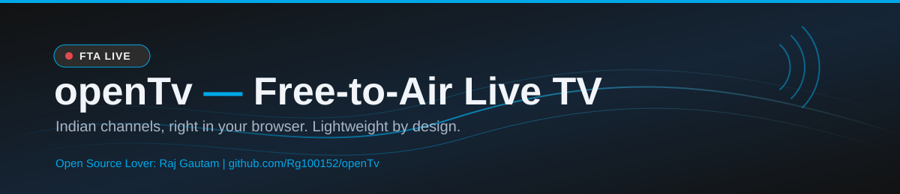
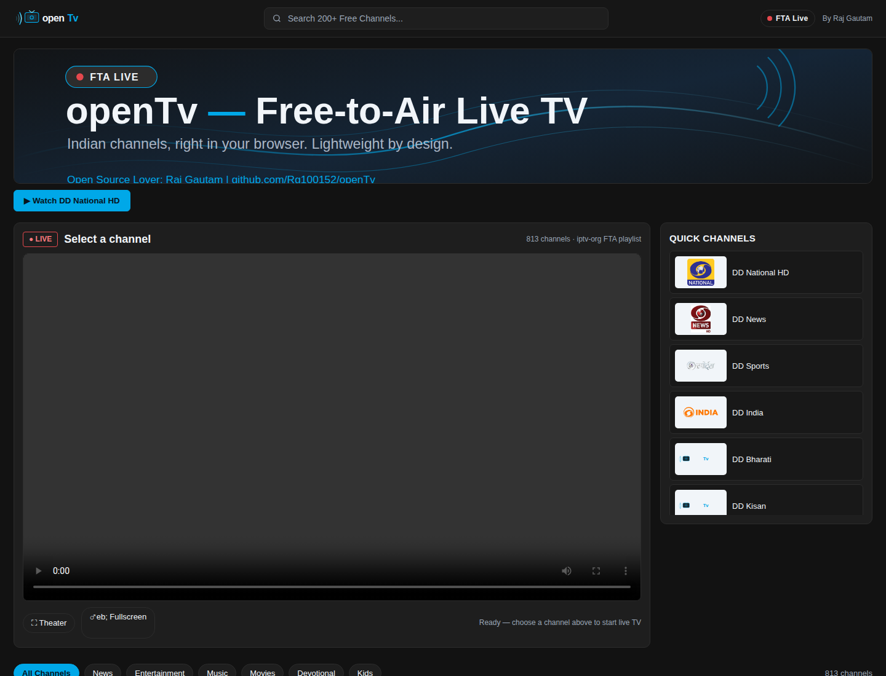
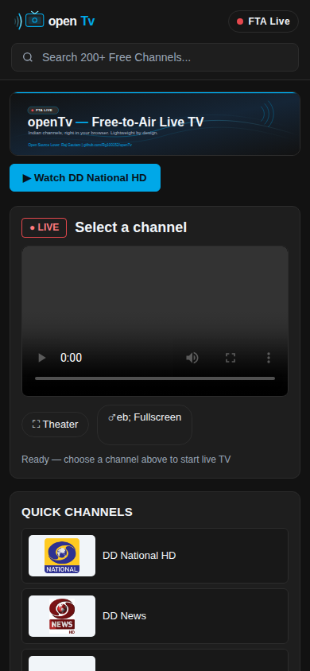

<div align="center">


# openTv

**Free-to-Air Live TV, straight from your browser.**  
Lightweight • Legal FTA channels • Zero animation • Made for low-RAM Linux machines


</div>

---

## 📡 Banner Preview



---

## 💙 A little note from me

> Namaste! मैं **Raj Gautam** — एक *Open Source Lover* — और ये छोटा सा प्रोजेक्ट मेरे उन सब लोगों के नाम है जो बिना किसी महंगे सब्सक्रिप्शन के, बस एक ब्राउज़र में अपने पसंदीदा भारतीय चैनल देखना चाहते हैं। 🇮🇳
>
> openTv को मैं तब बनाया जब मेरे पास एक कम RAM वाला Linux लैपटॉप था और भारी-भरकम OTT ऐप्स फैन चलाते थे। तो मैंने सोचा — **क्यों न एक साफ़, तेज़, बिना एनिमेशन वाला प्लेयर बनाया जाए?** बस एक पेज, एक प्लेयर, सब चैनल — और कोई बोझ नहीं।
>
> कोड खुला है, दिल खुला है। अगर आपको ये प्रोजेक्ट पसंद आए तो एक ⭐ देना ज़रूर भूलना मत।  
> **Built with ❤️ by Raj Gautam** — *Open Source Lover*

---

## 🖼️ Screenshots

### Desktop — OTT + Live Guide hybrid view



### Mobile — same experience in your pocket

<p align="center">
  
</p>

---

## ✨ Features

- 📺 **Live FTA Indian channels** from the public [iptv-org India playlist](https://iptv-org.github.io/iptv/countries/in.m3u) — 800+ channels.
- 🛡️ **Smart fallback**: if the playlist is offline, built-in Prasar Bharati channels (DD National, DD News, DD Sports, DD India, DD Bharati, DD Kisan) take over automatically.
- ⚡ **10-minute in-memory cache** — one fetch at startup, no browser polling, super fast page loads.
- 🔍 **Instant search** by channel name or category.
- 🏷️ **Category pills**: All, News, Entertainment, Music, Movies, Devotional, Kids.
- 🎬 **HLS.js player** with low buffer (`maxBufferLength: 15`, `maxMaxBufferLength: 30`) to stay kind to your RAM.
- 🧹 **No memory leaks** — `hls.destroy()` runs before every channel switch.
- 🚑 **Graceful error overlay** — “Stream Offline” instead of a black box or crash.
- ⏩ **Quick Channel sidebar** with popular DD channels one click away.
- 🎭 **Theater mode + Fullscreen** toggle.
- 🖼️ **Lazy-loaded logos** (`loading="lazy"`) so images load only when scrolled into view.
- 🌱 **CPU-friendly**: flat dark UI — no CSS keyframes, no pulsing, no box-shadows, no backdrop filters.
- 📱 **Responsive** — desktop, tablet and mobile.
- 📜 **MIT Licensed** — fork it, change it, share it.

---

## 🗂️ Project Structure

```
openTv/
├── app.py                          # Flask backend, M3U parser, cache & fallback
├── requirements.txt                # flask, requests
├── LICENSE                         # MIT License
├── README.md                       # You are reading this ❤️
├── docs/
│   ├── screenshot-desktop.png
│   └── screenshot-mobile.png
├── static/
│   ├── css/
│   │   └── style.css               # flat dark theme
│   └── images/
│       ├── opentv_logo.svg
│       └── hero_banner.svg
└── templates/
    └── index.html                  # UI + lightweight vanilla JS
```

---

## 🚀 Full Installation Guide

### 1. Prerequisites

- **Python 3.9+** (check with `python3 --version`)
- **Git**
- Internet connection for the first channel-list fetch *(optional — fallback works offline)*

Ubuntu / Pop!_OS / Debian:

```bash
sudo apt update
sudo apt install python3 python3-pip python3-venv git -y
```

Fedora:

```bash
sudo dnf install python3 python3-pip git -y
```

macOS (Homebrew):

```bash
brew install python git
```

Windows: install Python from [python.org](https://www.python.org/downloads/) and Git from [git-scm.com](https://git-scm.com/download/win).

---

### 2. Clone the repository

```bash
git clone https://github.com/Rg100152/openTv.git
cd openTv
```

Already have the folder? Just `cd` into it.

---

### 3. Create a virtual environment

Linux / macOS:

```bash
python3 -m venv .venv
source .venv/bin/activate
```

Windows (PowerShell):

```powershell
python -m venv .venv
.\.venv\Scripts\Activate.ps1
```

Windows (Command Prompt):

```cmd
python -m venv .venv
.venv\Scripts\activate.bat
```

Your prompt should now show `(.venv)` at the beginning.

---

### 4. Install dependencies

```bash
python -m pip install --upgrade pip
pip install -r requirements.txt
```

That's it — only **Flask** and **Requests**. No heavy frameworks, no Node, no build step.

---

### 5. Run the app

```bash
python app.py
```

You should see:

```
* Serving Flask app 'app'
* Running on all addresses (0.0.0.0)
* Running on http://127.0.0.1:5000
```

Open in your browser:

```
http://127.0.0.1:5000
```

Press `Ctrl + C` in the terminal to stop the server.

---

### 6. Watch on your phone (same Wi-Fi)

The server binds to `0.0.0.0`, so find your laptop's LAN IP:

```bash
hostname -I
```

Then open on your phone:

```
http://<your-laptop-ip>:5000
```

Example: `http://192.168.1.12:5000`

Make sure both devices are on the same Wi-Fi and your firewall allows port `5000`.

---

### 7. Super-quick start (if you’re impatient 😄)

```bash
git clone https://github.com/Rg100152/openTv.git && cd openTv && python3 -m venv .venv && source .venv/bin/activate && pip install -r requirements.txt && python app.py
```

---

### 8. Update later

```bash
cd openTv
git pull origin main
pip install -r requirements.txt
python app.py
```

### 9. Clean up / deactivate

```bash
deactivate          # leave the virtual environment
rm -rf .venv        # optional: delete the environment
```

---

## 🎮 How to use

| Action | What to do |
| --- | --- |
| Play a channel | Click any card, quick item, or the hero **Watch** button |
| Search | Type in the top search box — filtering is instant |
| Filter | Click a category pill below the player |
| Switch fast | Use the **Quick Channels** sidebar next to the player |
| Theater mode | Click **⛶ Theater** to hide the sidebar |
| Fullscreen | Click **⛶ Fullscreen** |
| Stream down | You’ll see a clean “Stream Offline” card — try another channel |

---

## 🔌 Optional JSON API

The UI renders channels with Jinja2 (no polling), but a small JSON endpoint is available if you want to build your own client:

```
GET http://127.0.0.1:5000/api/channels
```

Example response:

```json
{
  "count": 813,
  "source": "iptv-org FTA playlist",
  "channels": [
    {
      "name": "DD National HD",
      "logo": "https://.../DD%20National.png",
      "group": "Entertainment",
      "bucket": "entertainment",
      "stream": "https://fta.ektv.in/live/15/master.m3u8"
    }
  ]
}
```

---

## ⚙️ Configuration

Edit `app.py` if you need to change these:

| Setting | Default | Meaning |
| --- | --- | --- |
| `PLAYLIST_URL` | iptv-org India M3U | Source playlist |
| `CACHE_SECONDS` | `600` | Cache lifetime in seconds (10 min) |
| `REQUEST_TIMEOUT` | `8` | Startup fetch timeout |
| `app.run(host=..., port=...)` | `0.0.0.0`, `5000` | Bind address and port |

---

## 🧰 Troubleshooting

**“Stream Offline” on a channel?**  
Free-to-air streams can go down temporarily. Pick another channel — the playlist has hundreds. The overlay is intentional, not a crash.

**Player says HLS not supported?**  
openTv loads HLS.js from jsDelivr. Allow `cdn.jsdelivr.net`, or serve `hls.min.js` locally and update the `<script>` tag in `templates/index.html`.

**`Address already in use`?**  
Another process is on port 5000:

```bash
pkill -f "python app.py"
python app.py
```

**No internet at startup?**  
No problem — the built-in DD fallback list loads automatically. Reconnect and restart to refresh from the playlist.

**Channel logos missing?**  
Some third-party logo hosts block hotlinking. openTv silently replaces them with the local OpenTV logo.

---

## ⚖️ Legal note

openTv only lists **publicly available Free-to-Air** streams from the open iptv-org playlist. It does not host, re-stream, or bypass any paid/geo-restricted content. Please support official broadcasters and use the app responsibly.

---

## 🤝 Contributing

Pull requests are warmly welcome — better filters, favorites, remote number pad, light theme, local HLS bundle… bring your ideas! 🌟

```bash
git checkout -b feature/my-idea
git commit -m "Add my idea"
git push origin feature/my-idea
```

Then open a Pull Request on [GitHub](https://github.com/Rg100152/openTv).

---

## 📄 License

Released under the [MIT License](LICENSE). Do whatever good you want with it — just keep the credit and the love. ❤️

---

<div align="center">

### Made with patience, chai and ☕ by **Raj Gautam**

**Open Source Lover — Raj Gautam**  
[github.com/Rg100152/openTv](https://github.com/Rg100152/openTv)

*If this made your day a little easier, star the repo. It means a lot. ⭐*

</div>
